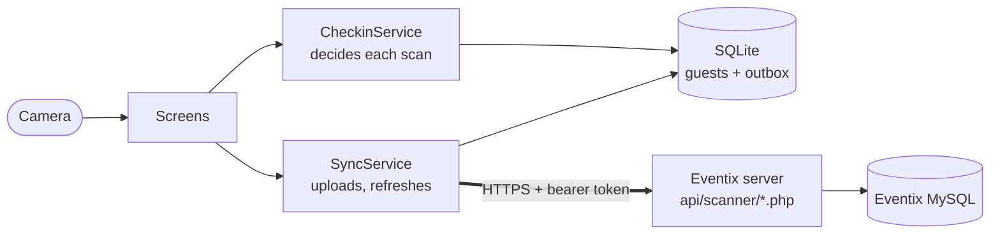

# Eventix Scanner

Door check-in for [Eventix](https://eventix.om) events: a Flutter app that
event staff use to check guests in by scanning the QR code on their invitation.
It works when the venue's network doesn't.

| Submission | |
|---|---|
| Candidate | Mohammed |
| Lane | **Mobile** (native iOS and Android apps) |
| Project | Eventix Scanner: offline-first QR check-in for event door staff |
| Outcome | **Android: complete**, tested on a real phone; the server API is live. **iOS: configured but not built or tested.** The only Mac available is too old to build for the test iPhone (see [Limitations](#known-limitations)). |
| Repository | <https://github.com/alraisi2581-web/eventix-scanner> |
| Version to review | The [latest release](https://github.com/alraisi2581-web/eventix-scanner/releases/latest): its tag, commit and Android APK |
| Time spent | About 5 hours of build work, 1–2 November 2026 |

## Contents

1. [Project and lane](#1-project-and-lane)
2. [Requirements and status](#2-requirements-and-status)
3. [Setup and run](#3-setup-and-run)
4. [Demo and access](#4-demo-and-access)
5. [Architecture and decisions](#5-architecture-and-decisions)
6. [Verification and limitations](#6-verification-and-limitations)
7. [Credits and contribution](#7-credits-and-contribution)

## 1. Project and lane

**Problem.** Guests arrive at an Eventix event with a QR code on their
invitation. Door staff used Eventix's web scanner, which needs the network for
every scan. A slow or dropped venue connection stops the queue. Two staff can
also both admit the same guest, because the web scanner reads and then writes
without a lock.

**Users.** Event door staff using a scanner account that an Eventix admin has
assigned to the event, on their own Android phone or iPhone.

**Main workflow.**
1. Sign in with the Eventix account.
2. Pick the event; its guest list downloads once.
3. Scan each guest's QR, or find them by name.
4. Get an instant green / amber / red answer, decided on the phone.
5. Check-ins upload in the background. Offline ones wait and go up later,
   never lost and never counted twice.
6. If two phones check in the same guest, the first to reach the server wins,
   and the other phone is told the guest was already checked in.

**Scope.**
- In: the app (Android and iOS source), the scanner API added to the existing
  Eventix server, English and Arabic.
- Out: guest management, invitations and undoing a check-in. These stay on the
  Eventix website.

**Assumptions.**
- One phone per staff member.
- Event sizes up to a few thousand guests: the real event this was built
  alongside has 969.
- Each phone downloads the guest list once while online before going offline.
- Phone clocks may be wrong, so they never decide who was first.

**Lane.** Mobile. Flutter compiles to native ARM code and draws with its own
native engine. Platform work goes through native APIs: the camera (CameraX with
ML Kit on Android, AVFoundation with Vision on iOS) and the Keychain / Keystore.
There is no WebView anywhere.

## 2. Requirements and status

These criteria restate, in measurable form, the requirements set on
1 November 2026 before the build. They were written into this README
afterwards.

Status:
- ✅ met, with evidence;
- 🔁 met in automated tests, the device recording still to come;
- ❌ not met.

| # | Acceptance criterion | Android | iOS | Evidence |
|---|---|---|---|---|
| A1 | A scanner account signs in with its Eventix username and password. A wrong password, a non-scanner account, a temporary password and too many attempts each get their own message. | ✅ | ❌ | [screens_test.dart](test/screens_test.dart) "sign-in" group; API checks "login: …" in [backend/evals](backend/evals/harness/scanner_api.php); device: signed in as Test Scanner |
| A2 | The account sees only its assigned events, and the guest list downloads once, without phone numbers, emails or raw QR tokens. | ✅ | ❌ | API checks "events: …", "guests: …"; [screenshot](docs/evidence/screenshots/android-03-events.png) |
| A3 | A scan answers without any network request: green "Checked in", amber "Already checked in · time", or red with what to do. | ✅ | ❌ | [checkin_flow_test.dart](test/checkin_flow_test.dart) "scanning on the phone"; screenshots [scanner](docs/evidence/screenshots/android-04-scanner.png), [amber](docs/evidence/screenshots/android-07-already-checked-in-arabic.png) |
| A4 | Offline check-ins survive closing the app and relaunching, and upload by themselves when the network returns. | 🔁 | ❌ | checkin_flow_test "offline: check-ins wait, nothing is lost…"; recording #7–9 |
| A5 | No duplicates: N check-ins made offline give exactly N on the server, and resending an upload (a lost reply) changes nothing. | 🔁 | ❌ | checkin_flow_test "an answer lost on the way back…"; API checks "the whole batch resent → all replayed", "the same upload sent 12 times at once → one check-in"; recording #8 |
| A6 | Two phones, one guest: exactly one check-in counts. The other phone shows "already checked in at …" until acknowledged, and keeps its own record of the scan. | 🔁 | ❌ | API check "16 phones check in one guest at once → exactly one"; checkin_flow_test "two phones, one guest"; recording #10 |
| A7 | Camera denied: an explanation, Open Settings, and check-in by name. After allowing it in Settings, the camera starts without leaving the screen. | ✅ | ❌ | screenshots [denied](docs/evidence/screenshots/android-01-camera-denied.png), [allowed](docs/evidence/screenshots/android-02-camera-allowed-after-settings.png); recording #1–2 |
| A8 | Input validation, and loading, empty and error states, on every screen. | ✅ | ❌ | screens_test "empty fields are refused…", "no events assigned…", "search by name: validation…"; [screenshot](docs/evidence/screenshots/android-05-search-by-name.png) |
| A9 | English and Arabic (right-to-left), light and dark. | ✅ | ❌ | screens_test "Arabic: right-to-left…"; screenshots [Arabic](docs/evidence/screenshots/android-07-already-checked-in-arabic.png), [dark](docs/evidence/screenshots/android-08-dark-mode.png) |
| A10 | No credentials or private data in Git; the token is kept in the Keychain or Keystore and stored hashed on the server. | ✅ | ✅ | [Security](#security-and-privacy); API check "only the SHA-256 of the token is stored" |
| A11 | Working native apps on **both** platforms. | ✅ | ❌ | Android: [release APK](https://github.com/alraisi2581-web/eventix-scanner/releases/latest), device screenshots. iOS: [not built](#known-limitations). |

## 3. Setup and run

**Versions.**
- Flutter 3.41.6 (stable), Dart 3.11.4.
- Android SDK 35, JDK 17.
- For iOS: Xcode with CocoaPods on macOS. A phone on iOS 27 needs Xcode 27.

All package versions are pinned in [pubspec.lock](pubspec.lock).

**Build and test:**

```bash
flutter pub get
```
```bash
flutter test
```
```bash
flutter build apk --release
```

**Expected results:**
- `flutter test` prints `All tests passed!` (31 tests).
- The build writes `build/app/outputs/flutter-apk/app-release.apk`.

On Windows, `flutter test` needs `SQLITE3_DLL` pointing at a `sqlite3.dll`;
Python ships one ([details](docs/testing.md)). If Gradle fails with "Unable to
establish loopback connection", set
`JAVA_TOOL_OPTIONS=-Djdk.net.unixdomain.tmpdir=C:\tmp\jdk`.

**Run on a phone.** Use `flutter run --release` with the phone connected, or
install the APK:
1. Download it from the [latest release](https://github.com/alraisi2581-web/eventix-scanner/releases/latest).
2. Open it on the phone, allow installing from that source, and tap Install.

The app needs Android 7.0 (API 24) or later. It is signed with a debug key,
which is fine for test phones.

**iOS.**
1. Open `ios/Runner.xcworkspace` in Xcode.
2. Set a signing team under Runner → Signing & Capabilities.
3. Run `flutter run --release` on a connected iPhone (iOS 13 or later).

**Configuration.**
- The server defaults to `https://eventix.om/`. Use another with
  `--dart-define=EVENTIX_BASE_URL=https://example.test/`.
- No keys or secrets are needed to build.

**Generated code.** Generated files (`*.g.dart`, `lib/l10n/app_localizations*.dart`)
are committed. Re-run `dart run build_runner build` after changing tables, and
`flutter gen-l10n` after changing texts.

**Continuous integration.**
[.github/workflows/android.yml](.github/workflows/android.yml) runs analysis and
the tests and builds the APK on every push. On a version tag it publishes the
APK as a release, so the downloadable build is made from the tagged source.

## 4. Demo and access

**What reviewers need, all provided separately through the hiring channel and
never in Git:**
- two scanner accounts, **Test Scanner** and **Test Scanner 2**, assigned only
  to the test event;
- the QR sheet for that event. Even for made-up guests, each QR is a live RSVP
  link, so it isn't published here.

**Live parts:**
- The app downloads from the [latest release](https://github.com/alraisi2581-web/eventix-scanner/releases/latest).
- The scanner API is live on `https://eventix.om`.
- The test event is *TEST - Scanner app (fake guests)*: 40 made-up guests, all
  marked do-not-contact. One, Saif Test-Alpha, is already checked in, for the
  "already in" case.

**Walkthrough** (about 10 minutes, one Android phone; a second phone adds step 7):
1. Install the APK and sign in as Test Scanner. The test event appears.
2. Tap it. The guest list downloads, then the scanner opens. Allow the camera.
3. Scan a guest's QR. **Expected:** green "Checked in", the name in English and
   Arabic, and the table. The status chip shows "Online · all uploaded".
4. Scan the same QR again. **Expected:** amber "Already checked in · time".
5. Turn on airplane mode and scan two more guests. **Expected:** both green at
   once, and the chip shows "Offline · 2 waiting". Swipe the app away and
   reopen it; the check-ins are still listed under Activity (the clock icon).
6. Turn airplane mode off. **Expected:** the chip returns to "all uploaded".
   To check the server's own count, sign in on a computer at
   <https://eventix.om/login> with the other test account and open the Scanner
   dashboard. The event's count rose by exactly 2: each check-in counted once,
   even though the phone tried to upload them while offline.
7. Two phones: phone B (Test Scanner 2) scans guest X offline; phone A scans X
   online; then phone B goes online. **Expected:** phone B shows a banner
   saying X was already checked in, and its scan didn't count.
8. Deny camera access in Android Settings and reopen the scanner.
   **Expected:** "Camera access is off", Open Settings, and Search by name,
   which still checks guests in.

Steps 3–8 are scenarios 3–10 of the
[device checklist](docs/testing.md#real-device-evidence-checklist).
Recordings: [docs/evidence/](docs/evidence/).

## 5. Architecture and decisions



| Document | Contents |
|---|---|
| [docs/architecture.md](docs/architecture.md) | System diagram, component responsibilities, on-phone data model, scan and two-phone sequences, app lifecycle, security |
| [docs/decisions.md](docs/decisions.md) | 17 decision records: options considered, the choice, who made it and why |
| [docs/backend-api.md](docs/backend-api.md) | The API contract, what was checked on the live server before building, deployment and rollback |
| [backend/](backend/) | The API's source, migration and 71 end-to-end tests (copied from the private Eventix code base) |
| [docs/operation.md](docs/operation.md) | Runbook: setting up an event, running the door, network loss, conflicts, after the event, troubleshooting |
| [docs/testing.md](docs/testing.md) | Tests, test data, and the device evidence checklist |

**Key decisions** (details in decisions.md):
- **Sign-in:** a 14-day bearer token, checked against the existing Eventix
  accounts, instead of the website's session cookie, which dies after 24 idle
  minutes.
- **Offline:** every scan is decided on the phone and recorded in an outbox in
  the same database transaction.
- **Duplicates and conflicts:** each check-in carries an ID made on the phone,
  so uploads are safe to repeat. The server locks the guest's row, so the first
  to reach it wins.
- **Privacy:** QR tokens reach phones only as hashes, and phone numbers and
  emails never do.
- **Design:** the Eventix web app's own design system.

**Supported OS versions:** Android 7.0 (API 24) or later; iOS 13 or later (set
by `flutter_secure_storage`).

**Backend dependencies:** Eventix with migration 030, and the five endpoints in
[backend/](backend/).

### Security and privacy

- **Nothing private in the repository:** no credentials or private data.
  Reviewer accounts and the QR sheet go out separately.
- **The sign-in token:** kept in the Keychain or Keystore; the server stores
  only its SHA-256. It ends on sign-out, a password change, a role change, or
  after 14 days.
- **Data on the phone:** guest lists hold only name, RSVP and table, and are
  deleted on sign-out. Android cloud backup is off.

## 6. Verification and limitations

**Automated:**
- 31 app tests (`flutter test`). They include two simulated phones against a
  fake server that follows the real server's rules: offline queue, a reply lost
  after the server applied it, 230 check-ins in 3 batches, first-to-server
  wins, sign-in expiry and a web undo.
- 71 API checks over real HTTP with genuinely parallel requests
  ([backend/evals](backend/evals/)). Removing the server's row lock makes the
  race check fail, which shows the test catches the bug.
- The existing Eventix suite (780 checks) still passes.
- CI runs the app tests on every push.

**On a real device:** a Samsung Galaxy S20 Ultra (SM-G988B), Android 13, against
the live server on 2 November 2026:
- sign-in, events, the camera scanner, check-in by name and the amber result;
- camera denied, then allowed in Settings;
- Arabic, dark mode and the activity list.

Screenshots: [docs/evidence/screenshots](docs/evidence/screenshots/). Recordings:
[docs/evidence](docs/evidence/).

The device check found three bugs, all fixed:
- the camera-denied screen flickered;
- the scan frame sat over the denied message;
- the result screen wasn't centred.

**What happens when things fail:**

| Failure | What the app does |
|---|---|
| No network | Scans continue. Uploads retry after 5 s, then longer, up to 60 s, and also when the network returns and when the app comes back to the front. |
| A reply lost after the server saved the check-in | The resend carries the same ID and is answered from the server's record. Nothing doubles. |
| Two phones, one guest | The first upload wins; the other is marked "didn't count" and shown on screen until acknowledged. |
| Sign-in ended (expired, password changed) | Back to sign-in; the queue waits and uploads once the same user signs in again. |
| App killed or phone dies | Every check-in shown on screen is already in SQLite and uploads on the next start. |
| Camera denied or broken | An explanation, Open Settings, and check-in by name. |

The full table is in [docs/architecture.md](docs/architecture.md#never-lost-never-doubled).

### Known limitations

1. **iOS was not built or tested.**
   - The test iPhone (iPhone 14 Pro, iOS 27.0.1) needs Xcode 27.
   - Xcode 27 needs an Apple-silicon Mac on macOS Tahoe 26.6 or later. The only
     Mac available, a MacBook Air 2019 (Intel), stops at macOS Sonoma.
   - The iOS project is configured: permissions, icons, launch screen, Podfile
     and minimum iOS 13.
   - **Next step:** build on an Apple-silicon Mac, or a cloud macOS build
     installed through TestFlight, which needs an Apple Developer account.
2. **No background uploads.** Check-ins upload only while the app is open,
   because iOS doesn't reliably allow background work. Queued check-ins wait
   safely.
3. **Full list downloads.** The app re-downloads the whole guest list every
   60 s while scanning, about 200 KB for 1,000 guests. This is simple and fine
   at this size. **Next:** download only changes, for very large events.
4. **No direct "sign out a lost phone" for admins.** A token ends on a password
   change, a role change, or after 14 days. **Next:** a list of signed-in
   devices in Eventix's admin area.
5. **Undo only on the website** (Scanner → Manual check-in). This is
   deliberate: it keeps sync one-way. The app picks up web undos on its next
   list refresh.
6. **The existing web scanner still has its race.** Two web scanners can both
   admit the same guest. Only the new API locks the guest's row. **Next:** move
   the web scanner onto the same check-in code.
7. **Times from the server** are labelled in the event's time zone; times from
   the phone use the phone's clock.

## 7. Credits and contribution

### External code, assets and services

| Package | Use | Licence |
|---|---|---|
| [Flutter](https://flutter.dev) | App framework | BSD-3-Clause |
| [flutter_riverpod](https://pub.dev/packages/flutter_riverpod) | State management | MIT |
| [drift](https://pub.dev/packages/drift), [drift_flutter](https://pub.dev/packages/drift_flutter), [drift_dev](https://pub.dev/packages/drift_dev) | SQLite database and code generation | MIT |
| [sqlite3](https://pub.dev/packages/sqlite3), [sqlite3_flutter_libs](https://pub.dev/packages/sqlite3_flutter_libs) | SQLite bindings and libraries (SQLite itself is public domain) | MIT |
| [mobile_scanner](https://pub.dev/packages/mobile_scanner) | Camera QR scanning: Google ML Kit on Android, Apple Vision on iOS | BSD-3-Clause |
| [flutter_secure_storage](https://pub.dev/packages/flutter_secure_storage) | Keychain / Keystore | BSD-3-Clause |
| [http](https://pub.dev/packages/http), [crypto](https://pub.dev/packages/crypto), [intl](https://pub.dev/packages/intl) | HTTP, SHA-256, date formatting | BSD-3-Clause |
| [connectivity_plus](https://pub.dev/packages/connectivity_plus) | Network change events | BSD-3-Clause |
| [uuid](https://pub.dev/packages/uuid) | Check-in IDs | MIT |
| [app_settings](https://pub.dev/packages/app_settings) | "Open Settings" when camera access is denied | MIT |
| [flutter_svg](https://pub.dev/packages/flutter_svg) | Draws the Eventix logo from its SVG | MIT |
| [flutter_launcher_icons](https://pub.dev/packages/flutter_launcher_icons), [flutter_native_splash](https://pub.dev/packages/flutter_native_splash) | Generate the app icon and launch screen (development only) | MIT |
| [build_runner](https://pub.dev/packages/build_runner), [flutter_lints](https://pub.dev/packages/flutter_lints) | Code generation and lints (development only) | BSD-3-Clause |

**Fonts:** bundled in `assets/fonts` with their licence files, under the SIL
Open Font License 1.1, from [Google Fonts](https://github.com/google/fonts):
- [DM Sans](https://github.com/googlefonts/dm-fonts), © 2014 The DM Sans Project Authors;
- [Playfair Display](https://github.com/clauseggers/Playfair), © 2017 The Playfair Display Project Authors;
- [Noto Naskh Arabic](https://github.com/notofonts/arabic), © 2022 The Noto Project Authors.

**Brand:** the Eventix logo, favicon and colours belong to Eventix
(`assets/brand`, from the Eventix website). The app icon and launch images were
rendered from those SVGs.

**Patterns:** camera start and stop on lifecycle changes follow the
[mobile_scanner README](https://pub.dev/packages/mobile_scanner#lifecycle-changes).

**Tools and services used:**
- Claude Code (AI assistance, below);
- GitHub, for hosting and the Actions CI;
- the existing Eventix server (a Linux VPS running nginx, PHP 8.3 and
  MySQL 8), which hosts the API, plus a private sandbox database on the same
  server for the API tests;
- Android SDK and adb, for device installs;
- Microsoft Edge in headless mode, to render the icon PNGs;
- Google Fonts, for the fonts.

### AI assistance

This project was built with Claude Code (Anthropic, model Claude Opus 5.5),
working in the Eventix code base and on the live server under my direction.
Claude:
- inspected the real system read-only before building: code, server
  configuration, database schema and live HTTP responses
  ([findings](docs/backend-api.md#what-was-checked-on-the-real-system-before-building));
- proposed options for each architectural decision, with a recommendation;
- wrote the server API, its migration and its 71 tests, ran the existing
  Eventix suite, and deployed to production after I approved it;
- wrote this app, its 31 tests and the documentation, and restyled it to the
  Eventix design system;
- installed and checked builds on my phone over USB, with screenshots.

Bugs caught by tests or on the device, and fixed:
- a crash when the sync controller was rebuilt;
- a timestamp-precision bug that would have blocked re-scanning a guest whose
  check-in was undone on the web;
- release builds with no internet permission;
- the camera-denied screen flickering and overlapping;
- the result screen not centred;
- server times reading backwards inside Arabic sentences;
- a real guest token copied into a test, which was replaced and removed from
  the history before publishing.

### My contribution

- **Problem and requirements:** I defined them: native apps, offline-first
  scanning, first-to-server wins, and how the losing phone is told.
- **Architecture decisions:** I made each one after the options were laid out
  ([decisions](docs/decisions.md)):
  - a device token over the session cookie;
  - a separate public repository;
  - deploying live with a fake-guest test event, with everything committed
    first for rollback;
  - telling the losing phone only "already checked in", as the web scanner does;
  - Riverpod and Drift;
  - English and Arabic;
  - undo on the web only;
  - matching the Eventix web design;
  - bundling the fonts.
- **Eventix itself:** I provided the system it builds on, its server and its
  accounts. I created the two test scanner accounts and assigned them to the
  test event.
- **Device testing:** I tested on my Android phone. That found the
  camera-denied flicker and overlap, and led to the design pass and the
  wording of the offline status.
- **The submission:** I checked it against the challenge brief and chose what
  to publish (the public app repository with the backend source, my own
  name and email on the commits).

This statement was drafted from the project history and the decision log.
