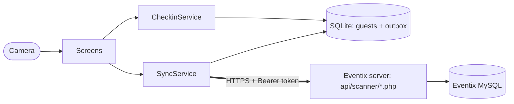

# Eventix Scanner

A native mobile app (Flutter, Android and iOS) that event staff use to check
guests in at the door by scanning the QR code on their invitation. It signs in
with an existing [Eventix](https://eventix.om) account, downloads the guest
list for the event, and decides every scan **on the phone**, so the door never
waits on the network. Check-ins go to the server live when online. They are
queued safely when offline and uploaded when the connection returns, never
lost and never counted twice. If two scanners check in the same guest, the
first to reach the server wins, and the other phone is told clearly that the
guest was already checked in.

## Contents

- [Features](#features)
- [Architecture](#architecture)
- [App lifecycle](#app-lifecycle)
- [Supported OS versions](#supported-os-versions)
- [Build and run](#build-and-run)
- [Backend dependencies](#backend-dependencies)
- [Testing](#testing)
- [Real-device evidence](#real-device-evidence)
- [Security and privacy](#security-and-privacy)
- [Project structure](#project-structure)
- [Credits](#credits)
- [AI assistance and my contribution](#ai-assistance-and-my-contribution)

## Features

| Requirement | How it is met |
|---|---|
| Staff sign in with their Eventix account | `api/scanner/login.php` on the Eventix server checks the same users, password hashes, roles and event permissions as the website. Scanner and admin accounts only. |
| Download the scanner's guest list | Events assigned to the account → guest list saved in SQLite (names, RSVP, table, QR token as SHA-256). |
| Scan against the list on the phone | `CheckinService` decides from the saved list. No network call happens between the scan and the green, amber or red result. |
| Live upload when online | Each check-in starts an upload at once. A status chip shows "Online · all uploaded". |
| Keep working offline; sync later without loss or duplicates | An outbox row is written in the same transaction as the scan. Uploads retry with the same UUID per check-in, and the server answers a repeat from its records. |
| First to the server wins; the other phone is told | The server locks the guest's row. The losing phone shows "X was already checked in at 7:03 pm. This phone's scan didn't count." Its own record of the scan stays. |
| Navigation | Sign-in → events → scanner → search by name / activity. Signing out or an expired sign-in returns to sign-in. |
| Local persistent data | Drift/SQLite (events, guest lists, outbox) plus the Keychain or Keystore (token). |
| Input validation | Sign-in fields, and the name search (at least 2 letters or a table number), before anything is sent. Server input is validated again on the server. |
| Loading, empty and error states | On every screen. For example, "No events yet — ask an admin", "Offline — showing what's saved on this phone", and retry buttons. |
| Device capability: camera | QR scanning with ML Kit (Android) and Apple Vision (iOS) via `mobile_scanner`. If camera access is denied: an explanation, Open Settings, and check-in by name. The camera stops and restarts with the app's lifecycle. |
| Languages | English and Arabic (right-to-left). |

## Architecture



The full system diagram, data model, scan and conflict sequences, and
security notes are in **[docs/architecture.md](docs/architecture.md)**. The
decisions behind them, and who made each one, are in
[docs/decisions.md](docs/decisions.md).

Stack: Flutter 3.41.6 / Dart 3.11 · Riverpod 2.6 (state) · Drift 2.31 (SQLite)
· mobile_scanner 7.4 (camera) · flutter_secure_storage 11 (token) · http.

## App lifecycle

- **Cold start**: reads the saved session. With a token, the app opens on the
  events screen even offline.
- **Scanner open**: uploads anything waiting, and re-downloads the open event's
  guest list every 60 s while online, so this phone learns about other
  scanners' check-ins.
- **Inactive or background**: the camera stops. Nothing needs saving, because
  every check-in is already committed to SQLite. Nothing runs in the
  background.
- **Resume**: the camera restarts (also after camera access was granted in
  Settings), uploads resume and the list refreshes.
- **Killed or crashed**: check-ins already shown are on disk and upload on the
  next start.
- **Sign-in ended by the server**: back to sign-in with the username filled in.
  Pending check-ins wait for the same user.

Details: [docs/architecture.md#app-lifecycle](docs/architecture.md#app-lifecycle).

## Supported OS versions

| Platform | Minimum | Set by | Tested on |
|---|---|---|---|
| Android | 7.0 (API 24) | `flutter_secure_storage` 11 | _fill in: device model, Android version_ |
| iOS | 13.0 | `flutter_secure_storage` 11 (mobile_scanner needs 12) | _fill in: device model, iOS version_ |

Built with Flutter 3.41.6 (stable), Dart 3.11, Android SDK 35, Java 17+, and
Xcode 16+ on macOS for iOS.

## Build and run

Prerequisites: Flutter 3.41.x; Android Studio with an Android SDK (for
Android); a Mac with Xcode and CocoaPods (for iOS).

```bash
flutter pub get
flutter test                      # Windows: set SQLITE3_DLL first (see docs/testing.md)
flutter run                       # a connected phone
```

Release builds:

```bash
flutter build apk --release       # Android: build/app/outputs/flutter-apk/app-release.apk
flutter build ipa                 # iOS, on a Mac (set your signing team in Xcode first)
```

- **Server.** The app talks to `https://eventix.om/` by default. To use another
  Eventix server, pass `--dart-define=EVENTIX_BASE_URL=https://example.test/`.
- **Signing.** The Android release build is signed with the debug key, which
  is fine for sideloading test phones. For a store build, add your own keystore
  through `android/key.properties`. Git ignores keystores and that file. iOS
  needs your Apple Developer team in Xcode (Runner → Signing & Capabilities).
- **Generated code.** The generated code (`*.g.dart`, `lib/l10n/app_localizations*.dart`)
  is committed. After changing the database tables run
  `dart run build_runner build`; after changing texts run `flutter gen-l10n`.
- **Windows.** Flutter warns when the Android SDK path contains a space. If
  Gradle fails with "Unable to establish loopback connection", set
  `JAVA_TOOL_OPTIONS=-Djdk.net.unixdomain.tmpdir=C:\tmp\jdk`.

## Backend dependencies

The app needs the **Eventix scanner API**, built for this project and added to
the existing Eventix server. It went live on eventix.om on 2026-11-01. Contract,
deployment and rollback are in **[docs/backend-api.md](docs/backend-api.md)**.

| Endpoint | Purpose |
|---|---|
| `POST api/scanner/login.php` | Eventix username + password → 14-day bearer token |
| `POST api/scanner/logout.php` | Revoke the token |
| `GET api/scanner/events.php` | Events assigned to the account |
| `GET api/scanner/guests.php?event_id=` | The guest list (no phones or emails; QR tokens as SHA-256) |
| `POST api/scanner/checkins.php` | Upload 1–100 check-ins; idempotent per `client_id` |

Server requirements: Eventix with migration **030** applied (tables
`api_tokens`, `scanner_checkins`), PHP 8.1+ and MySQL 8. Accounts and event
assignments are managed in Eventix (`admin/users.php`), as for the web
scanner.

Before building, the real system was checked rather than assumed. For example,
web sessions end after 24 idle minutes, and the nginx microcache ignores the
`Authorization` header. The findings are in
[docs/backend-api.md](docs/backend-api.md#what-was-checked-on-the-real-system-before-building).

## Testing

`flutter test` runs 31 tests:
- QR parsing;
- the full offline and sync flow with two simulated phones and a fake server
  that follows the real server's rules;
- 11 widget tests.

The server API has 71 end-to-end checks of its own in the Eventix repository,
including real parallel requests. See [docs/testing.md](docs/testing.md).

## Real-device evidence

The camera and offline behaviour must be shown on real phones, on both
platforms. The checklist of 14 scenarios is in
[docs/testing.md](docs/testing.md#real-device-evidence-checklist).
Recordings go in [docs/evidence/](docs/evidence/).

| Platform | Device | OS | Recordings |
|---|---|---|---|
| Android | _to fill in_ | | |
| iOS | _to fill in_ | | |

## Security and privacy

- No credentials or private data in this repository. The server URL is public.
  Test accounts are created in Eventix and never written here. The QR sheet for
  the test event is kept outside Git.
- The token is in the Keychain or Keystore. The server stores only its SHA-256.
  It ends on sign-out, password change, role change, or after 14 days.
- Guest lists on the phone hold names, RSVP and table only. They are deleted on
  sign-out, and Android cloud backup is off.

## Project structure

```
lib/
  main.dart, app.dart          app start, theme, languages, sign-in gate, lifecycle
  providers.dart               Riverpod wiring
  core/                        config, QR parsing
  data/api/                    Eventix API client + JSON models
  data/db/                     Drift database (+ generated code)
  data/session_store.dart      token + language in secure storage
  services/                    CheckinService (scan decisions), SyncService (uploads)
  ui/                          screens and widgets
  l10n/                        English and Arabic texts (ARB) + generated code
test/                          unit, flow and widget tests; fake Eventix server
docs/                          architecture, decisions, backend API, testing, evidence
```

## Credits

The app's own code is original. It is built on these open-source packages
(licence in brackets):

| Package | Use | Licence |
|---|---|---|
| [Flutter](https://flutter.dev) | UI framework | BSD-3-Clause |
| [flutter_riverpod](https://pub.dev/packages/flutter_riverpod) | State management | MIT |
| [drift](https://pub.dev/packages/drift), [drift_flutter](https://pub.dev/packages/drift_flutter), [drift_dev](https://pub.dev/packages/drift_dev) | SQLite database and code generation | MIT |
| [sqlite3](https://pub.dev/packages/sqlite3), [sqlite3_flutter_libs](https://pub.dev/packages/sqlite3_flutter_libs) | SQLite bindings and libraries (SQLite itself is public domain) | MIT |
| [mobile_scanner](https://pub.dev/packages/mobile_scanner) | Camera QR scanning: Google ML Kit barcode scanning on Android, Apple Vision on iOS | BSD-3-Clause |
| [flutter_secure_storage](https://pub.dev/packages/flutter_secure_storage) | Keychain / Keystore | BSD-3-Clause |
| [http](https://pub.dev/packages/http), [crypto](https://pub.dev/packages/crypto), [intl](https://pub.dev/packages/intl) | HTTP, SHA-256, date formatting | BSD-3-Clause |
| [connectivity_plus](https://pub.dev/packages/connectivity_plus) | Network change events | BSD-3-Clause |
| [uuid](https://pub.dev/packages/uuid) | Check-in ids | MIT |
| [app_settings](https://pub.dev/packages/app_settings) | "Open Settings" when camera access is denied | MIT |
| [build_runner](https://pub.dev/packages/build_runner), [flutter_lints](https://pub.dev/packages/flutter_lints) | Code generation, lints (development only) | BSD-3-Clause |

Patterns followed from documentation: camera start and stop on lifecycle
changes, as in the
[mobile_scanner README](https://pub.dev/packages/mobile_scanner#lifecycle-changes).
Eventix's colours come from the Eventix website's stylesheet.

## AI assistance and my contribution

**AI assistance.** This project was built with Claude Code (Anthropic, model
Claude Opus 5.5) working in my Eventix code base and on the live server. Claude:
- inspected the real system read-only before building (code, server
  configuration, database schema, live HTTP responses). The findings are in
  docs/backend-api.md.
- proposed options for each architectural decision, with a recommendation.
- wrote the server API, its migration and its 71 end-to-end tests, ran the
  existing Eventix test suite, and deployed to production after I approved it.
- wrote this Flutter app, its 31 tests, and the documentation.

Bugs found by tests during development, and fixed:
- a crash when Riverpod rebuilt the sync controller;
- a timestamp precision bug that would have blocked re-scanning a guest whose
  check-in an admin undid on the web;
- release Android builds that had no internet permission.

**My contribution.** I set the requirements: native app, offline-first,
first-to-server wins, and how conflicts are shown. I made the decisions
recorded in [docs/decisions.md](docs/decisions.md):
- device tokens over session cookies;
- a separate repository;
- deploying live with a fake-guest test event;
- telling the losing phone only "already checked in", as the web scanner does;
- Riverpod and Drift;
- English and Arabic;
- undo on the web only.

I provided the Eventix system, its server and its accounts.

Still to do, by me: create the test scanner accounts, test on real Android and
iOS devices, and make the recordings.

> _Owner: add here, in your own words, anything else you did — e.g. code you
> reviewed or changed, what you tested yourself, what you would do differently._
