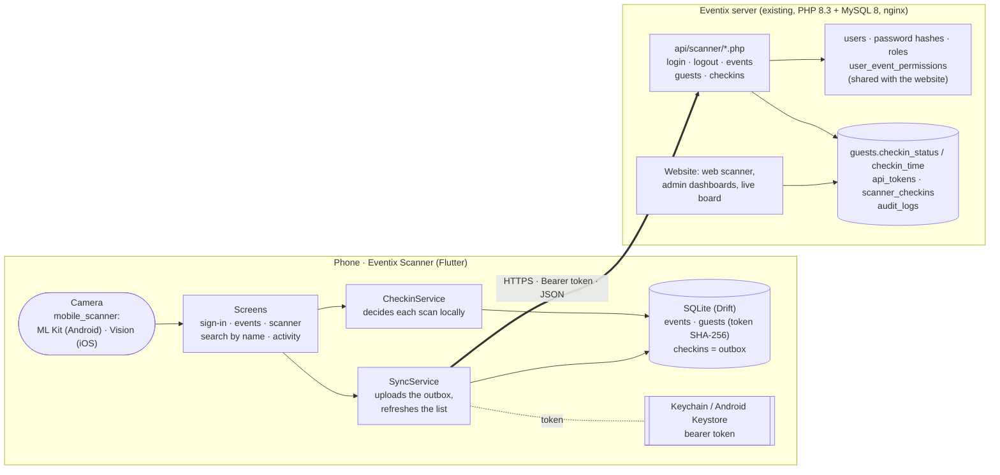
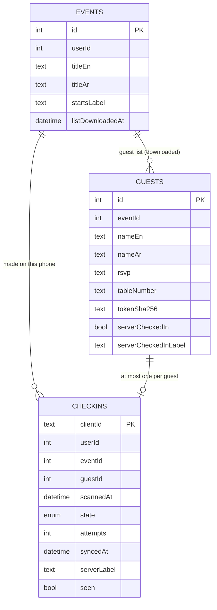
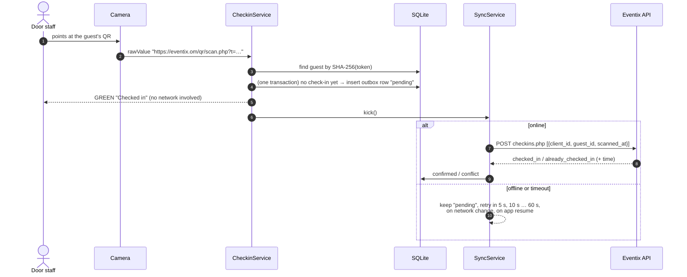
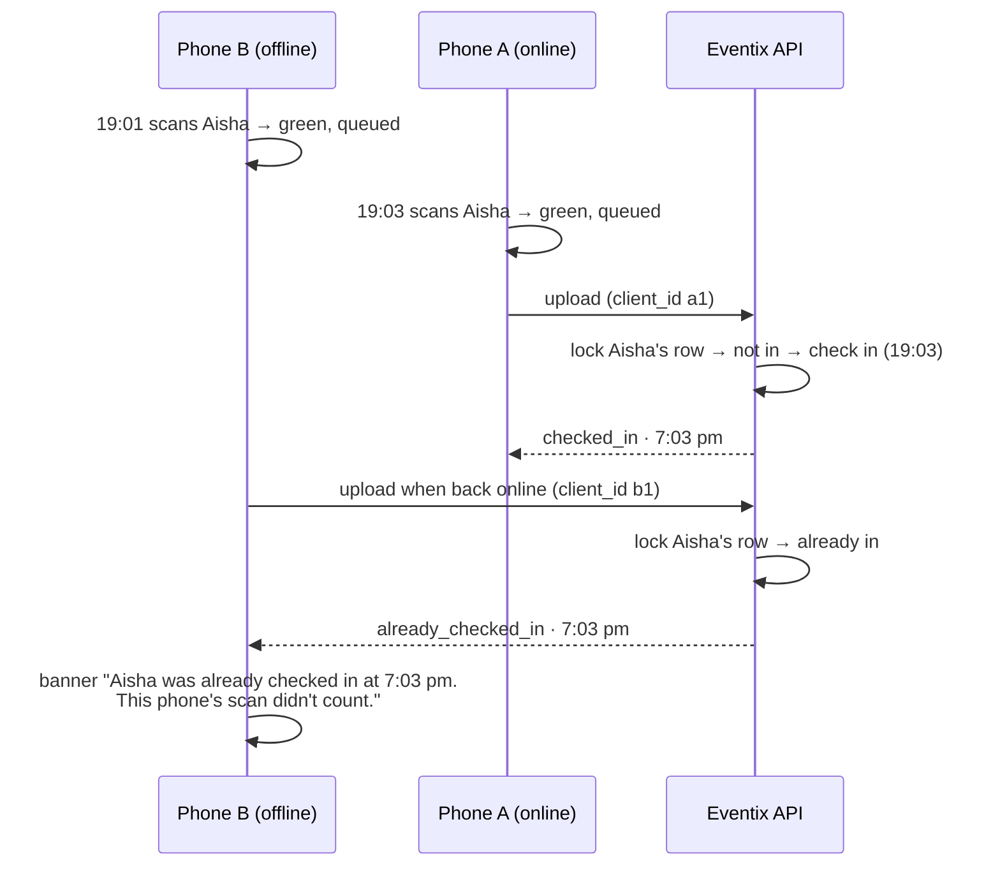

# Architecture

Eventix Scanner is a Flutter app (Android and iOS) that door staff use to check
guests in by scanning the QR code on their invitation. It works against the
existing Eventix server, and it keeps working when the venue's network does not.

## System diagram

The phone never asks the server whether to let someone in. It decides from the
guest list it downloaded, records the check-in locally, and uploads it in the
background. The server has the final word on who was first.

## Components

| Layer | Files | Responsibility |
|---|---|---|
| Screens | `lib/ui/*` | Sign-in, events, scanner, search by name, activity. Loading, empty and error states; English and Arabic (right-to-left). |
| State | `lib/providers.dart` | Riverpod providers that wire everything together: session, sync status, database streams. |
| Check-in logic | `lib/services/checkin_service.dart` | Turns one scan into an outcome (checked in, already in, not on the list, wrong event, not an invitation) and writes the outbox row in the same transaction. |
| Sync | `lib/services/sync_service.dart` | Uploads pending check-ins in batches of 100, applies the server's answers, re-downloads the open guest list every minute while online, backs off when offline. |
| Storage | `lib/data/db/database.dart` | Drift (SQLite) tables and queries. |
| Session | `lib/data/session_store.dart` | Token in secure storage; language choice. |
| API client | `lib/data/api/` | The Eventix scanner API; errors become typed exceptions. |
| QR parsing | `lib/core/qr.dart` | Reads `https://…/qr/scan.php?t=<token>` (or a bare token) and hashes the token. |

## Data on the phone

- **Guests** hold each QR token only as its SHA-256. The token is also the
  guest's RSVP link, so a lost phone must not hold it. The phone hashes what it
  scans and looks that up. No phone numbers or emails are downloaded.
- **Checkins** is an outbox. A row is `pending` until the server answers, then
  becomes `confirmed`, `conflict` (someone else reached the server first) or
  `rejected`. A unique key on (event, guest) means the first scan of a guest on
  this phone is the one kept. Later scans there only report it.
- The token is kept outside SQLite, in the Keychain or Keystore.

## How a scan flows

### Two scanners, one guest

The first check-in to **reach the server** wins, as required. Phone B's own
record (its 19:01 scan) stays on B, marked as a conflict. B is told clearly
that the guest is already checked in, with the time but not who did it. That
matches the web scanner (owner's decision).

### Never lost, never doubled

- **Not lost.** The outbox row is written in the same SQLite transaction that
  decides the scan. It is uploaded until the server answers it. Signing out,
  an expired sign-in and app restarts all keep pending rows.
- **Not doubled.** Every check-in carries a UUID made on the phone
  (`client_id`). If an upload reaches the server but the reply is lost, the
  phone sends the same `client_id` again. The server answers from
  `scanner_checkins` and changes nothing.
- **Races on the server.** The server locks the guest's row (`SELECT … FOR
  UPDATE`). Sixteen phones racing for one guest get exactly one
  `checked_in` (tested; removing the lock makes the test fail).

## App lifecycle

| Moment | What happens |
|---|---|
| Cold start | The session is read from secure storage. With a saved token the app opens on the events screen even with no network, showing the saved events. |
| Events screen | Refreshes the event list from the server; on failure keeps the saved list and shows "Offline". |
| Opening an event | Downloads its guest list the first time (needs the network once). |
| Scanner open | The sync engine knows the open event and re-downloads its list every 60 s while online, so this phone learns about other scanners' check-ins and web undos. |
| A scan | Decided and stored locally. An upload is started at once. |
| App goes inactive (call, app switcher) | The camera stops. Nothing needs saving: every check-in is already committed to SQLite. |
| App resumes | The camera restarts, including after camera access was granted in Settings. The outbox uploads and the list refreshes. |
| Network comes back | `connectivity_plus` reports it and an upload starts. A request that succeeds is the real test of being online. |
| In the background | Nothing runs (iOS doesn't allow it reliably). Pending check-ins upload the next time the app is in front. |
| App killed or phone dies | Check-ins already shown on screen are in SQLite and upload on the next start. |
| Server refuses the token (expired, revoked, password changed) | The app returns to sign-in with the username filled in. Pending check-ins wait and upload as soon as the same user signs in again. |
| Sign-out | The token is revoked if online. Downloaded guest lists are deleted. Pending check-ins stay, and the app asks first if any are waiting. |

## Security and privacy

- Sign-in uses the existing Eventix accounts: same password hashes, roles and
  event permissions. Only `scanner` and `admin` accounts can sign in. A
  temporary password is refused until the user chooses their own on the website.
- The bearer token is 256 bits of randomness. The server stores only its
  SHA-256. On the phone it lives in the Keychain or Keystore. It expires after
  14 days, and stops working on sign-out, a password change or a role change.
- Android `allowBackup=false`: the token and guest lists never go to cloud
  backups.
- The guest list on the phone has names, RSVP and table only. QR tokens are
  stored as hashes.
- All traffic is HTTPS to `eventix.om`. API responses are marked uncacheable
  (`X-Accel-Expires: 0`) because the server's 1-second nginx microcache keys
  on the URL alone.
